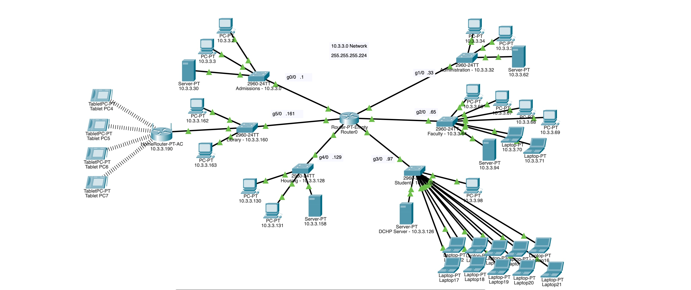

# Multi-Subnet Network Lab (Cisco Packet Tracer)

A six-subnet network with 35+ devices built in Cisco Packet Tracer (November 2025).

**Tools:** Cisco Packet Tracer · DHCP · Routing · Wireless · ACLs

## What I set up

- Static IPs and DHCP
- Routing between subnets
- Wireless access
- ACLs to block traffic between subnets that don't need to talk

## Testing

Used `ping` to check connectivity between subnets. When some subnets couldn't reach each other, I traced it through the routing and ACLs and fixed it.

---

Built by [Jordan Drake](https://github.com/jdrakegit) · [LinkedIn](https://www.linkedin.com/in/jordan-drake-a95471397)
